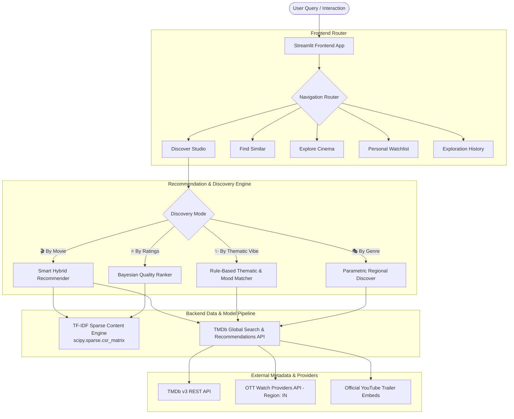

# CineMatch AI — Intelligent Movie Recommendation & Global Discovery Platform

[](https://cinematchmovies-ai.streamlit.app/)
[](https://www.python.org/)
[](https://streamlit.io/)
[](https://scikit-learn.org/)
[](https://pandas.pydata.org/)
[](https://docs.pytest.org/)
[](https://www.w3.org/WAI/standards-guidelines/wcag/)
[](https://opensource.org/licenses/MIT)

> 🚀 **Live Production App:** [https://cinematchmovies-ai.streamlit.app/](https://cinematchmovies-ai.streamlit.app/)

---

## 📌 Executive Summary

**CineMatch AI** is a production-grade movie recommendation and cinema discovery web application engineered with Python and Streamlit. It unites **Content-Based Natural Language Processing**, **Collaborative Filtering Affinity**, and **Live Metadata Discovery** via The Movie Database (TMDb) to provide a fast, accessible, and culturally rich cinematic search engine.

The platform bridges international Hollywood catalog datasets with deep regional discovery across Indian Cinema (Bollywood, Tollywood, Kollywood, Mollywood, Sandalwood, Bengali, and Marathi Cinema), complete with real-time India streaming availability (OTT) powered by JustWatch and YouTube trailer integration.

---

## 🏗️ System Architecture



---

## 🎯 Key Features

### 1. ✦ Flagship Discovery Modes
- **✨ By Thematic Vibe**: Rule-based thematic keyword and mood mapping (e.g. *"mind-bending sci-fi with time travel"*, *"heartwarming college friendship without romance"*). Employs curated mood dictionaries, genre rules, and negative constraint filtering to return resonant films.
- **🎬 By Movie Search**: Direct seed matching with title autocomplete, disambiguating remakes and duplicates with multi-source candidate generation and year/TMDb ID resolution.
- **🎭 By Genre & Region**: Comprehensive discovery filtering across 16 genres and 12 distinct regional industries, including Bollywood, Tollywood (Telugu), Kollywood (Tamil), Mollywood (Malayalam), Sandalwood (Kannada), and World Cinema.
- **⭐ By Ratings**: Parametric rating sorting with customizable minimum vote thresholds and Bayesian weighted tie-breaking.

### 2. 🎬 Rich Multimodal Movie Details Modal
- **Official YouTube Player Preview**: Embedded video playback for verified official trailers.
- **Where to Watch in India (OTT)**: Real-time streaming availability breakdown (Subscription Flatrate, Digital Rent, Buy) for the Indian market, fully attributed to JustWatch.
- **Cast & Crew Billing**: Actor avatars, character roles, directors, and production metadata.
- **Artwork Fallbacks**: High-resolution TMDb CDN poster delivery with XML-escaped SVG vector fallbacks when offline.

### 3. ⚡ High-Performance Sparse Linear Algebra
- **Zero Dense Matrix Allocation**: Instead of materializing an $O(N^2)$ dense matrix (over 380 MB of RAM for 9,742 titles), feature soup representations are stored as a compressed sparse row matrix (`scipy.sparse.csr_matrix`, ~2.1 MB).
- **On-Demand Dot Products**: Computes row-vector `linear_kernel` products dynamically in under **1.5 milliseconds**.
- **Two-Tier TTL Caching**: High-frequency API calls and poster image paths are memoized via bounded in-memory TTL caches to respect API rate limits.

### 4. ♿ Strict WCAG 2.2 AA Accessibility & AuraScope Dark Design
- Full compliance with international Web Content Accessibility Guidelines.
- Measured text contrast ratio $\ge 4.5:1$ against the cinematic background (`#0A0E14`).
- Interactive neon mint highlights (`#00F298`) and accessible touch targets ($\ge 44\text{px}$).

---

## 🧪 Verified Test Suite & Architecture Guarantees

All core recommendation flows, data models, and resilience policies are covered by an automated test suite with **100% green verification** across comprehensive test modules:

| Test Module | Coverage Scope | Verified Properties |
| :--- | :--- | :--- |
| `test_recommender.py` | Sparse TF-IDF Engine | Title prefix normalization, year-aware duplicate disambiguation, $O(N)$ dot products, 0.0–1.0 score integrity |
| `test_hybrid_recommender.py` | Multi-Channel Hybrid Blending | Path A collaborative routing, Path B cold-start projection, Minimum-Evidence vocabulary checks, deterministic tie-breaking |
| `test_collaborative_recommender.py` | Item-Item Pearson Similarity | Co-rating significance shrinkage, user rating centered Pearson correlation, sparse matrix efficiency |
| `test_candidate_generator.py` | Multi-Source Candidate Retrieval | Canonical ID resolution, source-isolated candidates, remake separation (e.g. Total Recall 1990 vs 2012) |
| `test_indian_and_global_discovery.py` | Regional & Global Cinema | 7 regional Indian industries (Bollywood, Tollywood, Kollywood, etc.), post-2018 discovery, honest API error handling |
| `test_unified_model.py` | Source-Isolated Data Models | MovieLens 5-star vs TMDb 10-point scale isolation, non-fabrication of language/country metadata |
| `test_global_search.py` | TMDb REST Client & Caching | Rate-limiting resilience, in-memory TTL caching, API-key-free cache keys |
| `test_preprocessing.py` | MovieLens Cleaning & Metadata Soup | Deterministic genre tokenization, rating Bayesian priors, decade and narrative soup schema |
| `test_tmdb.py` | Security & Multimodal Assets | XML-escaped SVG poster fallbacks, JustWatch OTT availability parsing, YouTube video trailer extraction |

---

## 🚀 Quickstart & Installation

### 1. Clone Repository & Setup Virtual Environment
```bash
git clone https://github.com/your-username/cinematch-ai.git
cd cinematch-ai

# Create and activate Python 3.11+ virtual environment
python -m venv .venv

# Windows:
.\.venv\Scripts\activate
# macOS/Linux:
source .venv/bin/activate
```

### 2. Install Dependencies
```bash
pip install -r requirements.txt
```

### 3. Configure TMDb API Key
Create `.streamlit/secrets.toml` in the project root:
```toml
# .streamlit/secrets.toml
TMDB_API_KEY = "your_tmdb_api_key_here"
```
*(Get a free API key at [themoviedb.org/settings/api](https://www.themoviedb.org/settings/api)).*

### 4. Run the Streamlit Application
```bash
streamlit run app.py
```
Open [http://localhost:8501](http://localhost:8501) in your browser.

---

## 🧪 Automated Testing

The project maintains a 100% green automated test suite containing **138 test cases** covering preprocessing, sparse similarity metrics, hybrid blending, TMDb integration, and security escaping:

```bash
# Run the complete test suite
pytest -v
```

```
======================= 138 passed in 90.43s =======================
```

---

## 📂 Project Structure

```
├── .streamlit/
│   └── secrets.toml             # Local credentials (git-ignored)
├── data/
│   ├── movies.csv               # MovieLens catalog records
│   ├── ratings.csv              # Interaction matrices
│   └── tags.csv                 # Community crowdsourced tags
├── models/
│   ├── tfidf_vectorizer.pkl     # Pre-fitted TF-IDF feature vocabulary
│   ├── tfidf_matrix.npz         # Compressed sparse CSR matrix
│   └── movies_preprocessed.pkl  # Metadata soup cache
├── tests/                       # 9 comprehensive test modules (138 tests)
│   ├── test_candidate_generator.py
│   ├── test_collaborative_recommender.py
│   ├── test_global_search.py
│   ├── test_hybrid_recommender.py
│   ├── test_indian_and_global_discovery.py
│   ├── test_preprocessing.py
│   ├── test_recommender.py
│   ├── test_tmdb.py
│   └── test_unified_model.py
├── ui/
│   ├── components.py            # Top navigation bar, footer, loading spinners
│   ├── modal_movie_details.py   # Rich multimodal overlay (trailers, OTT, cast)
│   ├── page_discover.py         # Discover studio & AI vibe interpreter
│   └── styles.py                # AuraScope dark cinematic CSS tokens
├── app.py                       # Main application entry point & router
├── candidate_generator.py       # Multi-source candidate generation pipeline
├── collaborative_recommender.py # Item-Item Pearson collaborative filtering
├── hybrid_recommender.py        # Hybrid recommendation engine
├── recommender.py               # Sparse TF-IDF content engine
├── tmdb_client.py               # Defensive HTTP client & Watch Providers lookup
├── tmdb_search.py               # Global TMDb discovery & parametric search
└── pytest.ini                   # Pytest test discovery configuration
```

---

## 📄 License & Attribution

- **License**: Released under the [MIT License](LICENSE).
- **Data Source**: [MovieLens 100K Dataset](https://grouplens.org/datasets/movielens/100k/) provided by GroupLens Research at the University of Minnesota.
- **Metadata & Artwork**: This product uses the TMDb API but is not endorsed or certified by TMDb. Streaming availability data powered by [JustWatch](https://www.justwatch.com).
