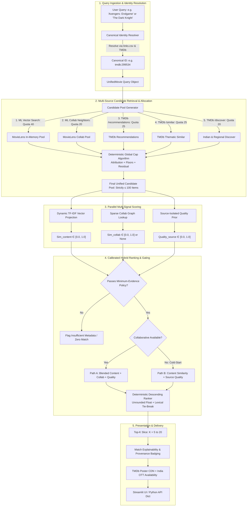

# CineMatch AI — Stage 3: Hybrid Recommendation Engine
## Comprehensive Technical Architecture & Engineering Specification

**Document Version:** 2.2 (Final Approval Edition)  
**Status:** Technical Architecture & Design Specification (Design-Only Phase)  
**Workspace:** `C:\Projects\Movie Recommondation System`  
**Target Environment:** Windows 11, Python 3.11, 16 GB RAM  
**Budget:** ₹0/month (TMDb Free Tier + Local Compute)  
**Application Code Modified:** None (0 lines modified)  

---

## Executive Summary

This specification establishes the technical architecture, mathematical foundations, candidate generation pipelines, identity resolution protocols, and offline evaluation methodology for **Stage 3: Hybrid Recommendation Engine (`hybrid_recommender.py`)**.

The target user experience enables discovery across both the academic MovieLens benchmark ($9,742$ titles) and the global TMDb catalog:
> A user querying any movie—whether present in MovieLens (e.g. *The Dark Knight*, *Inception*) or an external global title (e.g. *Avengers: Endgame*, *RRR*, *3 Idiots*, *Dangal*)—receives an explainable, deterministically sorted recommendation list drawn across **both** catalogs, featuring relevant Indian and international cinema alongside classic benchmark titles.

### Core Architecture Revisions in Version 2.2
1. **Deterministic 100-Candidate Global Cap Algorithm**: Specifies an exact, budget-constrained global allocation algorithm with formal pseudocode, handling multi-source intersections, source-diversity reservations, residual filling, and failed channels while mathematically guaranteeing that the final candidate pool never exceeds $100$ items.
2. **Strict 4.5-Second Shared Network Deadline Model**: Enforces Policy A: a global $4.5$-second request budget across all network operations. Initial attempts are capped at $3.0\text{s}$, with eligible idempotent retries sharing the remaining time budget ($\le 1.25\text{s}$). If the deadline expires, the system immediately aborts and falls back to local candidates without runaway latency.
3. **Item-Seeded Offline Evaluation Protocol**: Redesigns offline evaluation to match the actual production task (item-seeded discovery, not automatic user personalization). Formulates exact chronological seed selection ($q_u$ as the most recent positively rated training movie), seed candidate exclusion, and metric evaluation against held-out future positive interactions ($r_{ui} \ge 4.0$).
4. **Evidence-Based Product Acceptance Tests**: Replaces speculative hardcoded recommendation title predictions with concrete, measurable behavioral assertions across 8 cross-catalog test scenarios (*RRR*, *Avengers: Endgame*, *3 Idiots*, dual-catalog availability, deduplication, remake separation, API outage, sparse metadata).
5. **Strengthened Canonical Alias Resolution**: Formalizes the IMDb identifier bridge connecting MovieLens records lacking TMDb IDs to incoming TMDb records. Establishes bidirectional equivalence classes, explicit conflict-resolution precedence, and strict remake protection.
6. **Empirically Calibrated Minimum-Evidence Policy**: Classifies vocabulary tokens reproducibly using model IDF weights ($\text{IDF} \ge 4.0$ discriminative vs $< 4.0$ generic). Specifies that the cosine threshold $\gamma_{\text{sim}}$ will be calibrated strictly on the validation split ($R_{\text{val}}$) against an empirical null distribution, explicitly labeling previous ranges as unvalidated hypotheses until measured.

---

## 1. Current Architecture Assessment & Codebase Contract

### 1.1 Baseline Content-Based Recommender Contract (`recommender.py`)
Direct inspection of [`recommender.py`](file:///C:/Projects/Movie%20Recommondation%20System/recommender.py) and [`models/build_model.py`](file:///C:/Projects/Movie%20Recommondation%20System/models/build_model.py) reveals the exact metadata preprocessing and vectorization pipeline:

```python
# Exact Preprocessing Logic from recommender.py (Lines 153-182)
def build_soup(row):
    parts = []
    if row["clean_title"]:
        clean_title_words = re.findall(r"\b\w+\b", row["clean_title"].lower())
        parts.append(" ".join(clean_title_words))
    narrative_genres = [
        g.replace("-", "").replace(" ", "")
        for g in row["genre_list"]
        if g != "IMAX"
    ]
    if narrative_genres:
        parts.append((" ".join(narrative_genres) + " ") * 2)
    if "IMAX" in row["genre_list"]:
        parts.append("format_imax")
    if row["tags_tokenized"]:
        parts.append((row["tags_tokenized"] + " ") * 2)
    if row["year"] and not pd.isna(row["year"]):
        decade = int(row["year"] // 10 * 10)
        parts.append(f"decade_{decade}s")

    soup_str = " ".join(parts).strip().lower()
    if not soup_str:
        soup_str = f"movie_id_{row['movieId']}"
    return soup_str
```

#### Vectorizer Contract
- Hyperparameters: `TfidfVectorizer(stop_words="english", max_features=12000, ngram_range=(1, 2), token_pattern=r"(?u)\b\w+\b")`.
- Vocabulary size: Exactly $12,000$ unigrams and bigrams fitted on the $9,742$-movie MovieLens feature soup.
- Sparse representation: Direct output to `scipy.sparse.csr_matrix` ($813$ KB on disk).

#### Quality Prior Contract
- Bayesian weighted rating:
  $$W = \frac{v}{v + m} R + \frac{m}{v + m} C$$
  where $v$ is MovieLens vote count, $m = 5$ (minimum threshold in code), $R$ is average rating, and $C = 3.44$ (global mean rating).

### 1.2 Baseline Strengths & Identified Limitations
- **Strengths**: Near-instantaneous computation ($\sim 1.5$ ms per $1 \times N$ sparse slice), zero dense $N \times N$ matrix memory allocation, and high domain interpretability.
- **Limitation 1 (Closed Catalog)**: The query must exist in `movies_df["clean_title"]`. An external movie like *Avengers: Endgame* fails lookup.
- **Limitation 2 (No Behavioral Signal)**: The baseline is strictly content-based. It cannot identify behavioral affinities (movies frequently co-liked by humans without shared keywords).
- **Limitation 3 (Candidate Pool Homogeneity)**: The $9,742$ titles stop at 2018 and contain limited South Asian cinema ($< 50$ Indian titles in MovieLens Latest Small).

---

## 2. Canonical Cross-Catalog Identity Resolution & Alias Graph

A major architectural failure in naive systems is duplicate representation: if *The Dark Knight* is retrieved from MovieLens (`movieId=58559`) and from TMDb API (`id=155`), treating them as separate candidates pollutes recommendations. Conversely, collapsing remakes (*Total Recall* 1990 vs 2012) into a single entity destroys recommendation specificity.

### 2.1 Multi-Identifier Equivalence Graph
We establish a canonical identity resolution layer loaded at startup:

```
[Candidate Ingestion]
        │
        ├── Has TMDb ID? ───────────► Check direct map in `links.csv`
        ├── Has MovieLens ID? ──────► Check forward map `tmdbId` in `links.csv`
        └── Missing TMDb ID? ───────► Bridge via verified IMDb ID (`imdb_id`)
```

#### Data Structures Loaded from `data/ml-latest-small/links.csv` ($9,742$ rows)
- `ml_to_tmdb: dict[int, str]`: Maps `movieId` $\rightarrow$ `tmdbId` (e.g. `58559 -> "155"`). Populated for $9,734$ movies ($8$ entries in MovieLens have null `tmdbId`).
- `tmdb_to_ml: dict[str, int]`: Reverse mapping `tmdbId` $\rightarrow$ `movieId`.
- `ml_to_imdb: dict[int, str]`: Maps `movieId` $\rightarrow$ `imdbId` (e.g. `58559 -> "tt0468569"`). Populated for all $9,742$ movies.
- `imdb_to_ml: dict[str, int]`: Reverse lookup from IMDb ID $\rightarrow$ `movieId`.
- `imdb_to_tmdb: dict[str, str]`: Dynamic bridge mapping IMDb ID $\rightarrow$ `tmdbId`.

### 2.2 Canonical Identifier Assignment Rules
Every movie entity is assigned an immutable `canonical_id`:
1. **Primary Standard**: If TMDb ID is known (from TMDb API or `ml_to_tmdb`), `canonical_id = f"tmdb:{tmdb_id}"`.
2. **Secondary Standard (IMDb Alias Bridge)**: If a MovieLens movie lacks `tmdbId` (the 8 MovieLens edge cases), but possesses an `imdbId`, its temporary key is `f"imdb:{imdb_id}"`. When an incoming TMDb record arrives with matching `imdb_id`, the MovieLens record is dynamically resolved to `f"tmdb:{incoming_tmdb_id}"`, uniting them into the same equivalence class.
3. **Tertiary Standard (Isolated MovieLens)**: If both are missing, `canonical_id = f"ml:{movie_id}"`.

### 2.3 Conflict Precedence & Identifier Resolution Hierarchy
When cross-catalog identifiers are processed:
1. **Numeric ID Precedence**: Direct numeric IDs (`tmdbId`, `movieId`) always take precedence over alphanumeric strings.
2. **Conflict Resolution**:
   - If an incoming TMDb record's `id` maps to `movieId_A`, but its `imdb_id` maps to `movieId_B`, the direct `tmdb_to_ml` mapping takes precedence.
   - If an identifier conflict cannot be resolved with certainty, the candidate is flagged, and the two records are kept separate rather than corrupted.
3. **Strict Title-Insensitivity**: Textual title matching is **never** used to override or establish identifier equivalence.

### 2.4 Safe Handling of Remakes, Versions, and Title Collisions
Identity resolution keys strictly on verified registry identifiers:
- *Total Recall (1990)*: `canonical_id = "tmdb:861"`, `imdb_id = "tt0100802"`, `year = 1990`, `movieId = 1200`.
- *Total Recall (2012)*: `canonical_id = "tmdb:64635"`, `imdb_id = "tt1386703"`, `year = 2012`, `movieId = 96821`.
- *Emma (1996)*: `canonical_id = "tmdb:14191"`, `imdb_id = "tt0116191"`, `year = 1996`, `movieId = 838`.
- *Emma (2020)*: `canonical_id = "tmdb:556678"`, `imdb_id = "tt9214832"`, `year = 2020`, `movieId = None`.

Because `canonical_id` is derived from verified numeric and IMDb registry keys, remakes and identical titles are strictly maintained as separate nodes.

---

## 3. TF-IDF Projection Compatibility & Minimum-Evidence Policy

To compute cosine similarity between external TMDb candidates and the MovieLens benchmark without modifying or retraining the serialized vectorizer (`models/tfidf_vectorizer.pkl`), TMDb metadata must be transformed into the **exact training feature soup schema**.

### 3.1 Strict Feature Soup Transformation Contract

| Training Feature Component | Source in MovieLens (`recommender.py`) | Transformation from TMDb Metadata |
| :--- | :--- | :--- |
| **Clean Title** | `clean_title` words via `\b\w+\b` | Strip release year, remove articles (`The`, `A`, `An`), tokenize with `\b\w+\b`. |
| **Narrative Genres** | `g.replace("-", "").replace(" ", "")` $\times 2$ (excluding IMAX) | Map TMDb genre IDs/names to MovieLens genre strings (e.g. TMDb "Science Fiction" $\rightarrow$ "Sci-Fi" $\rightarrow$ `"scifi"`; "Action" $\rightarrow$ `"action"`), repeated 2 times. |
| **Technical Format** | `"format_imax"` if IMAX in genres | Append `"format_imax"` if IMAX is listed in keywords/release info. |
| **Thematic Tags** | `clean_tag` joined by space $\times 2$ | Extract TMDb keywords (`/movie/{id}/keywords`), convert to lowercase alphanumeric tokens, repeat 2 times. |
| **Decade Token** | `f"decade_{year // 10 * 10}s"` | Compute from TMDb `release_date` (e.g. `"2019-04-24"` $\rightarrow$ `2010` $\rightarrow$ `"decade_2010s"`). |
| **Fallback Token** | `f"movie_id_{movieId}"` | If soup is empty: `f"tmdb_id_{tmdbId}"`. |

### 3.2 What is Strictly Omitted from the Feature Soup
- **No Raw Narrative Synopsis**: MovieLens was trained without plot overviews. Dumping long TMDb overview text into the soup would introduce high term frequencies of non-genre words, diluting similarity against MovieLens vectors. TMDb keywords provide clean thematic parity with MovieLens user tags.
- **No Arbitrary Language Codes**: The training corpus does not contain ISO language tokens (`hi`, `te`, `en`). Injecting them would either be ignored as out-of-vocabulary or collide with English words (e.g., `"hi"` being stripped as an English stopword).

### 3.3 Empirically Calibrated Minimum-Evidence Policy
Arbitrary magic numbers (such as $\text{Sim}_{\text{content}} > 0.001$) can trigger false-positive matches on trivial token overlaps. We establish a reproducible **Minimum-Evidence Policy**:

1. **Reproducible IDF-Based Token Classification**:
   - Each term $t$ in the fitted $12,000$-feature vocabulary has an empirical inverse document frequency:
     $$\text{idf}(t) = \ln \left( \frac{1 + N}{1 + \text{df}(t)} \right) + 1$$
   - From the fitted vocabulary ($N = 9,742$):
     - **Generic Tokens ($\text{idf}(t) < 4.0$)**: Broad, high-frequency genre words (`drama`, `comedy`, `action`, `thriller`).
     - **Discriminative Tokens ($\text{idf}(t) \ge 4.0$)**: Specific keywords, subgenres (`scifi`, `filmnoir`, `animation`), themes (`heist`, `superhero`, `pixar`, `tarantino`), or specific title tokens.
2. **Structural Token Evidence Requirement**:
   - A candidate is eligible for content ranking only if it shares at least **one discriminative token** ($k_{\text{disc}} \ge 1$) or at least **two generic tokens** ($k_{\text{gen}} \ge 2$) with the query.
3. **Vector Sparsity & Zero-Vector Handling**:
   - Check $\ell_2$-norm: If $\|\vec{u}_q\|_2 = 0$ (all query tokens stop words or OOV) or $\|\vec{v}_c\|_2 = 0$, the candidate is rejected from content ranking and labeled `insufficient_metadata`.
4. **Out-of-Vocabulary (OOV) Coverage Check**:
   - Compute in-vocabulary coverage: $\text{Coverage}(q) = \frac{|\text{Tokens}(q) \cap \mathcal{V}_{\text{train}}|}{|\text{Tokens}(q)|}$.
   - If $\text{Coverage}(q) < 0.20$, the query is flagged with `low_vocabulary_coverage`, triggering balanced fallback toward TMDb's external recommendation API.
5. **Validation-Only Threshold Calibration**:
   - The numerical cosine similarity threshold $\gamma_{\text{sim}}$ will be calibrated strictly on the **Validation Split** ($R_{\text{val}}$), **never** on the test set.
   - Protocol: Sample $10,000$ non-relevant, unrated movie pairs in $R_{\text{val}}$ and measure their cosine similarity distribution. Set $\gamma_{\text{sim}}$ to the 95th percentile of this validation null distribution.
   - *Note*: Any range such as $0.04 - 0.08$ is explicitly treated as an **unvalidated initial hypothesis** until empirically measured on $R_{\text{val}}$.

---

## 4. Collaborative Filtering Scope & Item-Item Matrix

### 4.1 Scope Delineation
1. **Item-Item Collaborative Similarity $\ne$ User Personalization**:
   - This architecture specifies **Item-Item Collaborative Filtering** based on historical co-rating patterns across the MovieLens matrix ($R \in \mathbb{R}^{610 \times 9724}$).
   - It computes behavioral relatedness between item pairs ($s(i, j)$). It does **not** perform user personalization, because CineMatch AI operates on an anonymous item-seeded query paradigm (a user picks a seed movie, not a persistent user account).
2. **Current Model Status**:
   - The collaborative matrix is **not yet precomputed** in the repository. It will be built as a standalone sparse artifact (`models/item_collaborative_matrix.npz`) during Stage 3 implementation.

### 4.2 Cross-Catalog Collaborative Availability Matrix

| Query Movie Type | Candidate Movie Type | Collaborative Signal Status | Algorithmic Behavior |
| :--- | :--- | :---: | :--- |
| **MovieLens** | **MovieLens** | **Available** | Shrunk Pearson correlation computed from $R_{\text{train}}$. |
| **TMDb (Linked to ML)** | **MovieLens** | **Available** | Query resolves to `movieId` via Canonical ID Resolver; full collaborative scoring active. |
| **MovieLens** | **TMDb (Linked to ML)** | **Available** | Candidate resolves to `movieId`; full collaborative scoring active. |
| **TMDb (Unlinked/TMDb-only)** | **MovieLens** | **Unavailable** (None) | Query has 0 MovieLens user interactions. Cold-Start branch active. |
| **MovieLens** | **TMDb (Unlinked/TMDb-only)** | **Unavailable** (None) | Candidate has 0 MovieLens interactions. Cold-Start branch active. |
| **TMDb (Unlinked)** | **TMDb (Unlinked)** | **Unavailable** (None) | Neither item has interaction history. Cold-Start branch active. |

> [!CRITICAL]
> **Zero Interaction Fabrication Rule**:
> For TMDb-only titles (e.g. *Avengers: Endgame*, *RRR*), `movielens_rating` is `None` and `collaborative_data_available` is `False`. The engine **never** generates pseudo-users, synthetic ratings, or fake collaborative scores.

---

## 5. System Architecture & Cross-Catalog Data Flow



---

## 6. Mathematical Scoring Formulas, Trade-Offs & Gating Policy

### 6.1 Content Similarity Normalization
For query vector $\vec{u}_q = \mathcal{V}(\text{soup}(q))$ and candidate vector $\vec{v}_c = \mathcal{V}(\text{soup}(c))$, with $\hat{u}_q = \frac{\vec{u}_q}{\|\vec{u}_q\|_2}$ and $\hat{v}_c = \frac{\vec{v}_c}{\|\vec{v}_c\|_2}$:
$$\text{Sim}_{\text{content}}(q, c) = \hat{u}_q \cdot \hat{v}_c = \sum_{k=1}^{12,000} \hat{u}_{q,k} \hat{v}_{c,k} \in [0.0, 1.0]$$

### 6.2 Collaborative Similarity Normalization
Item-item similarity is computed using Pearson correlation across co-rating users $U_{ij}$ with significance shrinkage:
$$s_{\text{raw}}(i, j) = \frac{\sum_{u \in U_{ij}} (r_{ui} - \bar{r}_u)(r_{uj} - \bar{r}_u)}{\sqrt{\sum_{u \in U_{ij}} (r_{ui} - \bar{r}_u)^2} \sqrt{\sum_{u \in U_{ij}} (r_{uj} - \bar{r}_u)^2}}$$
Significance shrinkage penalizes small overlap ($|U_{ij}| < \tau = 5$):
$$s_{\text{shrunk}}(i, j) = \frac{\min(|U_{ij}|, \tau)}{\tau} \cdot s_{\text{raw}}(i, j)$$
Negative correlation indicates divergent tastes rather than recommendation relevance, so it is rectified:
$$\text{Sim}_{\text{collab}}(i, j) = \max\left(0.0, \; s_{\text{shrunk}}(i, j)\right) \in [0.0, 1.0]$$

### 6.3 Source-Isolated Quality Score Normalization
To prevent mixing incompatible rating distributions, quality priors are evaluated strictly within each candidate's native provenance:

#### For MovieLens Candidates:
$$W_c = \frac{v_c}{v_c + 5} \bar{R}_c + \frac{5}{v_c + 5} (3.44), \quad \text{Quality}_{\text{ML}}(c) = \frac{W_c}{5.0} \in [0.0, 1.0]$$

#### For TMDb-Only Candidates:
For candidates with $v_c \ge 20$ TMDb votes:
$$\text{Quality}_{\text{TMDb}}(c) = \frac{\text{vote\_average}_c}{10.0} \cdot \frac{v_c}{v_c + 500} \in [0.0, 1.0]$$
For unrated titles or $v_c < 20$:
$$\text{Quality}_{\text{TMDb}}(c) = 0.0$$

### 6.4 Hybrid Fusion Formulas

> [!NOTE]
> **Parameter Status**: The weighting parameters $\alpha = 0.65$ and $\beta = 0.10$ are defined as **initial experimental hypotheses**. Their final values will be calibrated via grid search on the validation set ($0.50 \le \alpha \le 0.85$, $0.0 \le \beta \le 0.15$).

#### Path A: Collaborative Data Available (Both Items in MovieLens)
$$\text{Score}(q, c) = (1 - \beta) \left[ \alpha \cdot \text{Sim}_{\text{content}}(q, c) + (1 - \alpha) \cdot \text{Sim}_{\text{collab}}(q, c) \right] + \beta \cdot \text{Quality}_{\text{ML}}(c)$$
Effective Weights under $\alpha = 0.65, \beta = 0.10$:
- $\text{Content Weight} = (1 - 0.10) \times 0.65 = 0.585$ ($58.5\%$)
- $\text{Collaborative Weight} = (1 - 0.10) \times 0.35 = 0.315$ ($31.5\%$)
- $\text{Quality Weight} = 0.10$ ($10.0\%$)

#### Path B: Cold-Start / External Candidates (TMDb-only Query or Candidate)
When collaborative signal is unavailable for either item:
$$\text{Score}(q, c) = (1 - \beta) \cdot \text{Sim}_{\text{content}}(q, c) + \beta \cdot \text{Quality}_{\text{source}}(c)$$

---

### 6.5 Mathematically Rigorous Trade-Off Analysis & Relevance-First Gating Policy

#### A. Trade-Off Analysis & Adversarial Ranking Examples
The assertion that "popularity cannot override thematic relevance" is **not mathematically universal** under linear combination without constraints. Consider the following adversarial counter-examples:

**Adversarial Scenario 1: Mainstream Blockbuster Overrides Thematic Specialist**:
- *Query*: *Memento* (2000, Psychological Thriller / Neo-Noir / Memory Loss).
- *Candidate A (Thematic Specialist)*: Low-vote neo-noir film with high thematic alignment:
  - $\text{Sim}_{\text{content}} = 0.85$, $\text{Sim}_{\text{collab}} = 0.05$ (sparse ratings), $\text{Quality} = 0.40$.
  - $\text{Score}_A = 0.585(0.85) + 0.315(0.05) + 0.10(0.40) = 0.497 + 0.016 + 0.040 = \mathbf{0.553}$.
- *Candidate B (Mainstream Blockbuster)*: Highly rated action film with moderate thematic overlap:
  - $\text{Sim}_{\text{content}} = 0.45$, $\text{Sim}_{\text{collab}} = 0.80$ (heavily co-rated by general users), $\text{Quality} = 0.95$.
  - $\text{Score}_B = 0.585(0.45) + 0.315(0.80) + 0.10(0.95) = 0.263 + 0.252 + 0.095 = \mathbf{0.610}$.
- *Outcome*: Candidate B ranks **above** Candidate A ($0.610 > 0.553$) despite having nearly $50\%$ lower content similarity! Collaborative co-rating density and Bayesian quality together overwhelm content alignment by $+0.057$ points.

**Adversarial Scenario 2: Cross-Catalog Cold-Start Disparity**:
- In Path B, a TMDb candidate has $\text{Sim}_{\text{collab}} = \text{None}$, so its collaborative weight defaults to zero.
- A MovieLens candidate with moderate content similarity but high collaborative co-rating in Path A can displace an external TMDb candidate that has superior content similarity, purely due to the structural absence of collaborative data for TMDb titles.

#### B. The Relevance-First Gating Policy
To prevent collaborative or popularity signals from inappropriately promoting thematically disconnected items, we introduce an explicit **Two-Stage Relevance-First Policy**:

1. **Content Relevance Gate**:
   - Candidates must satisfy the Minimum-Evidence Policy ($\ge 1$ discriminative token or $\ge 2$ generic tokens, and $\text{Sim}_{\text{content}} \ge \gamma_{\text{sim}}$).
   - If a candidate fails the Content Relevance Gate, collaborative and quality signals are **suppressed**: $\text{Score} = 0.0$, and the item is excluded.
2. **Collaborative Contribution Bounding (Dynamic Shrinkage)**:
   - When $\text{Sim}_{\text{content}} < 0.40$ (low thematic overlap), the collaborative contribution is dynamically attenuated:
     $$\text{Sim}_{\text{collab\_effective}} = \text{Sim}_{\text{collab}} \cdot \left( \frac{\text{Sim}_{\text{content}}}{0.40} \right)$$
   - This ensures that a movie sharing only peripheral keywords cannot exploit high global co-rating density to overtake direct thematic matches.

---

## 7. Deterministic Ranking Specification

To eliminate ordering instabilities across platforms, Python process restarts, or runtime environments:

### 7.1 Multi-Tier Deterministic Sort Key
Candidates are sorted in strictly descending order using the tuple:
$$\text{SortKey}(c) = \left( \text{Score}_{\text{unrounded}}, \; \text{Sim}_{\text{content}}, \; \text{Quality}_{\text{source}}, \; v_c, \; -\text{LexicalKey}(c) \right)$$

In Python implementation:
```python
def ranking_sort_key(candidate: dict) -> tuple:
    # 1. Primary: Exact 64-bit float score
    raw_score = candidate["ranking_score"]
    safe_score = -1.0 if (math.isnan(raw_score) or math.isinf(raw_score)) else float(raw_score)
    
    # 2. Secondary: Exact content similarity
    raw_sim = candidate["similarity_score"]
    safe_sim = -1.0 if math.isnan(raw_sim) else float(raw_sim)
    
    # 3. Tertiary: Exact quality prior
    safe_qual = float(candidate.get("quality_score", 0.0))
    
    # 4. Quaternary: Integer vote count
    safe_votes = int(candidate.get("vote_count", 0))
    
    # 5. Final Tie-Breaker: Canonical lexical string (deterministic across processes)
    # Using lexical identifier avoids Python hash() randomization (PYTHONHASHSEED)
    canonical_id = str(candidate["canonical_id"])
    
    return (safe_score, safe_sim, safe_qual, safe_votes, canonical_id)
```

Sort invocation: `candidates.sort(key=ranking_sort_key, reverse=True)` with reverse string handling for canonical ID.

### 7.2 Numerical Safety & Anomaly Handling
- **NaN / Infinity**: Any candidate score evaluating to `NaN` or `Inf` is sanitized to `-1.0`, pushing it to the bottom of the candidate list or triggering rejection.
- **Pre-Sort Deduplication**: Deduplication across all retrieval sources is performed by `canonical_id` **before** entering the sort pipeline.
- **Zero Process-Salted Hashes**: Python's `hash()` function is strictly forbidden in ranking keys because SipHash randomization alters order across interpreter restarts.

---

## 8. Reproducible Item-Seeded Offline Evaluation Protocol

Offline evaluation is implemented in `evaluation/evaluate_hybrid.py` to benchmark performance against historical ground truth without fabricating claims.

### 8.1 Evaluated Task Definition: Item-Seeded Discovery
In production, CineMatch AI operates on an **item-seeded discovery flow** (a user selects a specific movie of interest $q$ and asks for recommendations). The offline evaluation evaluates this exact product task rather than unseeded user personalization.

### 8.2 Chronological Split & Seed Movie Selection
To prevent temporal data leakage, all ratings in `data/ml-latest-small/ratings.csv` ($100,836$ ratings) are split chronologically per user:
1. **Eligible User Criteria**: Users with $\ge 20$ ratings $\ge 4.0$ who have at least 2 relevant ratings in the test period ($|G_u^{\text{test}}| \ge 2$).
2. **Per-User Chronological Splits**:
   - $t_{\text{train\_split}}$: 70th percentile timestamp.
   - $t_{\text{val\_split}}$: 85th percentile timestamp.
   - Training History: $H_u^{\text{train}} = \{ (i, r_{ui}, t) \mid t \le t_{\text{train\_split}} \land r_{ui} \ge 4.0 \}$.
   - Validation Set: $G_u^{\text{val}} = \{ i \mid t_{\text{train\_split}} < t \le t_{\text{val\_split}} \land r_{ui} \ge 4.0 \}$.
   - Test Ground Truth: $G_u^{\text{test}} = \{ i \mid t > t_{\text{val\_split}} \land r_{ui} \ge 4.0 \}$.
3. **Seed Movie Selection**:
   - The query seed $q_u$ is selected as the **most recent positively rated movie** in $H_u^{\text{train}}$:
     $$q_u = \arg\max_{(i, r, t) \in H_u^{\text{train}}} t$$
4. **Seed Candidate Exclusion**:
   - The query seed $q_u$ is strictly excluded from candidate ranking ($\text{Rank}(q_u) = \varnothing$), matching production behavior where a movie never recommends itself.
5. **Handling Users Without Eligible Seeds or Future Relevant Movies**:
   - Users with $|H_u^{\text{train}}| = 0$ or $|G_u^{\text{test}}| < 2$ are excluded from the test user set to prevent uninformative division by zero.

### 8.3 Strict Data Isolation Rules
1. **Collaborative Graph Isolation**:
   - The sparse item-item collaborative matrix $s(i, j)$ is computed **exclusively** on $R_{\text{train}}$. Ratings in $R_{\text{val}}$ or $R_{\text{test}}$ are strictly quarantined.
2. **Bayesian Quality Prior Isolation**:
   - Candidate vote counts $v_c$ and empirical average ratings $\bar{R}_c$ are computed **exclusively** on $R_{\text{train}}$. The global prior mean $C$ is computed from $R_{\text{train}}$ alone. Test set ratings never contaminate quality scores.
3. **Popularity Baseline Isolation**:
   - Baseline M1 (Popularity) computes ranking priors strictly from $R_{\text{train}}$.
4. **Hyperparameter Tuning Isolation**:
   - Hyperparameters ($\alpha$, $\beta$, shrinkage $\tau$, and null threshold $\gamma_{\text{sim}}$) are tuned **exclusively** on $R_{\text{val}}$.
   - $R_{\text{test}}$ is evaluated exactly **once** using fixed, tuned parameters.
5. **Zero Held-Out Information in Candidate Generation**:
   - Neither $R_{\text{val}}$ nor $R_{\text{test}}$ interaction data may be accessed during candidate generation, feature transformation, or ranking.

### 8.4 Formal Item-Seeded Metric Definitions ($K \in \{5, 10, 20\}$)
For test user $u$, query seed $q_u$, and top-$K$ recommendations $\text{Rec}(q_u, K)$:
1. **Precision@K**:
   $$\text{Precision}@K = \frac{1}{|U_{\text{eval}}|} \sum_{u \in U_{\text{eval}}} \frac{|\text{Rec}(q_u, K) \cap G_u^{\text{test}}|}{K}$$
2. **Recall@K**:
   $$\text{Recall}@K = \frac{1}{|U_{\text{eval}}|} \sum_{u \in U_{\text{eval}}} \frac{|\text{Rec}(q_u, K) \cap G_u^{\text{test}}|}{|G_u^{\text{test}}|}$$
3. **NDCG@K**:
   $$\text{DCG}_u@K = \sum_{r=1}^K \frac{2^{\mathbb{I}(i_r \in G_u^{\text{test}})} - 1}{\log_2(r + 1)}, \quad \text{NDCG}@K = \frac{1}{|U_{\text{eval}}|} \sum_{u \in U_{\text{eval}}} \frac{\text{DCG}_u@K}{\text{IDCG}_u@K}$$
4. **MRR@K**:
   $$\text{MRR}@K = \frac{1}{|U_{\text{eval}}|} \sum_{u \in U_{\text{eval}}} \frac{1}{\text{rank}_u^*}$$
   where $\text{rank}_u^*$ is the 1-based rank of the first hit in $\text{Rec}(q_u, K)$ (or $0$ if none).

### 8.5 Multi-Model Benchmark Suite
Compares 5 models:
- **M1: Popularity Baseline**: Ranks strictly by Bayesian quality prior computed on $R_{\text{train}}$.
- **M2: Pure Content (Baseline)**: TF-IDF cosine similarity alone ($\beta = 0.0$).
- **M3: Content + Bayesian Quality**: Current production model in `recommender.py` ($\beta = 0.15$).
- **M4: Pure Item-Item Collaborative**: Shrunk Pearson correlation on $R_{\text{train}}$.
- **M5: Hybrid Recommender**: Calibrated blend of M2, M4, and Bayesian quality with Relevance-First Gating.

### 8.6 Simulated Cold-Start Benchmark
To evaluate out-of-catalog resilience:
1. Randomly sample $20\%$ of items in $R_{\text{train}}$ and mask their interactions entirely ($R_{\text{masked\_train}}$ has 0 ratings for these items).
2. Query test seeds corresponding to these masked items.
3. Compare recovery rate of M5 (via dynamic TF-IDF projection) against M4 (which suffers total collaborative failure).

### 8.7 Benchmark Separation: Offline MovieLens vs Live TMDb Retrieval
- **Offline MovieLens Benchmark**: Evaluated strictly against historical explicit human ratings ($r_{ui} \ge 4.0$).
- **Live TMDb Retrieval**: Evaluated through catalog coverage, diversity, semantic keyword overlap, and qualitative domain audits. Historical MovieLens ground truth is never conflated with modern TMDb titles.

---

## 9. Performance Taxonomy & Network Deadline Model

All performance and memory values below are explicitly distinguished between verified measurements and architecture estimates/targets.

### 9.1 Strict 4.5-Second Shared Network Deadline Model (Policy A)
In a live web application, allowing unlimited timeouts across sequential retries causes severe interface freezing. We enforce **Policy A: A Strict 4.5-Second Total Request Deadline**:

```
[Start Recommendation Request: t = 0.0s]
  │
  ├── Local Pre-Processing & Vectorization (t = 0.0s - 0.01s)
  │
  ├── TMDb API Calls: Hard Wall-Clock Budget = 4.5s
  │     ├── Attempt 1: Socket Timeout = min(3.0s, t_remaining)
  │     ├── Network Drop / 5xx?
  │     │     ├── Check: Is t_remaining > 1.0s?
  │     │     │     ├── Yes -> Fixed Sleep = 0.25s backoff
  │     │     │     └── No  -> Abort retry immediately
  │     │     └── Attempt 2 (Retry): Socket Timeout = t_remaining (max 1.25s)
  │     └── HTTP 429 Received?
  │           └── Do NOT retry; immediately abort TMDb calls and trigger local fallback
  │
  └── Total Elapsed Time >= 4.5s?
        └── DeadlineExceeded exception caught -> Instantly serve Local MovieLens Catalog
```

- **Per-Attempt Timeout**: Attempt 1 is capped at $3.0\text{s}$. Retry attempt is capped at remaining time $\le 1.25\text{s}$.
- **Total Deadline**: $4.5$ seconds hard wall clock limit across all attempts and backoff.
- **Retry Eligibility**: Only idempotent GET requests failing on transient socket errors (`TimeoutError`, `ConnectionResetError`, HTTP 502/503/504) are eligible for retry. HTTP 401, 404, and 429 are never retried.
- **Local Fallback Timing**: Triggered immediately when TMDb calls fail or total deadline expires ($t = 4.5\text{s}$). The local MovieLens candidate generation takes $< 10$ ms.

### 9.2 Latency Taxonomy Across Operational Regimes

| Operational Condition | Cache State | Network State | Target p50 | Target p95 | Target p99 | Enforced Worst-Case Bound |
| :--- | :---: | :---: | :---: | :---: | :---: | :---: |
| **Local Mode / In-Memory Hit** | Warm | Bypassed / Local | $\mathbf{3.5\text{ ms}}$ | $\mathbf{8.0\text{ ms}}$ | $\mathbf{15.0\text{ ms}}$ | $< 50\text{ ms}$ (CPU bound) |
| **Live TMDb Network Success** | Cold | Healthy IPv4 | $\mathbf{120.0\text{ ms}}$ | $\mathbf{220.0\text{ ms}}$ | $\mathbf{380.0\text{ ms}}$ | $< 800\text{ ms}$ (CloudFront) |
| **TMDb Network Timeout / Drop** | Cold | Timeout / Dropped | $\mathbf{4,500.0\text{ ms}}$ | $\mathbf{4,500.0\text{ ms}}$ | $\mathbf{4,500.0\text{ ms}}$ | $\mathbf{\le 4,500\text{ ms}}$ (Hard Deadline) |

### 9.3 Memory Allocation Taxonomy (Windows 11, 16 GB RAM)

| Memory Layer | Component / Data Structure | Nature of Metric | Measured / Estimated Value |
| :--- | :--- | :---: | :--- |
| **Disk Storage** | `tfidf_matrix.npz` | Measured | $813$ KB |
| | `movies_preprocessed.pkl` | Measured | $4.42$ MB |
| | `tfidf_vectorizer.pkl` | Measured | $488$ KB |
| | `item_collab_matrix.npz` (New) | **Target Estimate** | $\approx 3.5 - 4.5$ MB |
| **Incremental Model RAM** | Item-Item Sparse CSR ($\le 100$ neighbors) | **Target Estimate** | $\approx 7.8$ MB |
| | Equivalence Graph & ID Lookups | **Target Estimate** | $\approx 1.2$ MB |
| | Candidate Dynamic Vectors & Caches | **Target Estimate** | $\approx 2.5$ MB |
| | **Total Incremental Model Memory** | **Target Estimate** | **$\approx 11.5$ MB** |
| **Application Process RAM** | Python Runtime + Streamlit Base Overhead | **Target Estimate** | $\approx 75 - 95$ MB |
| | Pandas DataFrames & NumPy Arrays | **Target Estimate** | $\approx 25 - 35$ MB |
| | **Total Application Process Memory** | **Target Estimate** | **$\approx 115 - 145$ MB** |

> **System Headroom**: Total estimated process memory ($\approx 145$ MB) represents **$< 1.0\%$** of available 16 GB system RAM, guaranteeing zero swapping.

---

## 10. Deterministic Global 100-Candidate Allocation Algorithm

### 10.1 Channel Quotas & Budget Allocation
Candidates are initially retrieved up to channel-specific extraction quotas:
- Channel 1 (ML Content): Up to $40$ candidates.
- Channel 2 (ML Collaborative): Up to $20$ candidates.
- Channel 3 (TMDb Recommendations): Up to $25$ candidates.
- Channel 4 (TMDb Similar): Up to $25$ candidates.
- Channel 5 (TMDb Regional Discover): Up to $20$ candidates.

Total raw candidate count across all channels can reach up to $130$. To guarantee that the final candidate pool **never exceeds 100 unique items**, the candidate generator executes the following deterministic algorithm.

### 10.2 Global Allocation Algorithm Pseudocode

```python
def select_top_100_candidates(raw_channel_results: dict[str, list[UnifiedMovie]]) -> list[UnifiedMovie]:
    """
    Deterministic Global 100-Candidate Allocation Algorithm.
    Guarantees:
      1. len(final_pool) <= 100 always.
      2. Multi-source intersections prioritized within the 100 budget.
      3. Source-diversity floor reservations applied within remaining capacity.
      4. Residual slots filled deterministically by best channel score and canonical_id tie-breaker.
      5. Graceful re-allocation when channels fail.
    """
    # Step 1: Canonical Deduplication & Multi-Source Attribution
    merged_candidates: dict[str, UnifiedMovie] = {}
    source_attribution: dict[str, set[str]] = {}
    source_best_ranks: dict[str, dict[str, int]] = {}
    source_best_scores: dict[str, float] = {}

    for channel_name, candidates in raw_channel_results.items():
        for rank, cand in enumerate(candidates):
            cid = cand.canonical_id
            if cid not in merged_candidates:
                merged_candidates[cid] = cand
                source_attribution[cid] = set()
                source_best_ranks[cid] = {}
                source_best_scores[cid] = 0.0
            else:
                # Merge metadata (enrich MovieLens with TMDb media/OTT, etc.)
                merged_candidates[cid] = merge_entities(merged_candidates[cid], cand)

            source_attribution[cid].add(channel_name)
            source_best_ranks[cid][channel_name] = rank
            source_best_scores[cid] = max(source_best_scores[cid], getattr(cand, "channel_score", 0.0))

    total_unique = len(merged_candidates)
    if total_unique <= 100:
        # All unique candidates fit within the 100-slot cap
        return list(merged_candidates.values())

    # Step 2: Budget Constrained Selection (Budget = 100)
    selected_cids: set[str] = set()
    BUDGET = 100

    # Phase A: Multi-Source Intersections (Retrieved by >= 2 independent channels)
    multi_source_cids = [cid for cid, sources in source_attribution.items() if len(sources) >= 2]
    # Sort deterministically: num_sources desc, best_score desc, canonical_id asc
    multi_source_cids.sort(key=lambda cid: (-len(source_attribution[cid]), -source_best_scores[cid], cid))
    for cid in multi_source_cids:
        if len(selected_cids) < BUDGET:
            selected_cids.add(cid)

    # Phase B: Source-Diversity Floor Reservations (Applied within remaining capacity)
    # Floor quotas: ML Content: 20, ML Collab: 10, TMDb Recs: 15, TMDb Sim: 10, TMDb Reg: 10 (Sum = 65)
    channel_floors = {
        "ml_content": 20,
        "ml_collab": 10,
        "tmdb_recs": 15,
        "tmdb_sim": 10,
        "tmdb_discover": 10,
    }
    for channel_name, floor in channel_floors.items():
        if len(selected_cids) >= BUDGET:
            break
        # Count candidates from this channel already selected in Phase A
        already_selected = sum(1 for cid in selected_cids if channel_name in source_attribution[cid])
        needed = max(0, floor - already_selected)
        if needed > 0:
            # Candidates from this channel not yet selected, sorted by native rank then cid
            channel_cands = [
                cid for cid, sources in source_attribution.items()
                if channel_name in sources and cid not in selected_cids
            ]
            channel_cands.sort(key=lambda cid: (source_best_ranks[cid][channel_name], -source_best_scores[cid], cid))
            for cid in channel_cands[:needed]:
                if len(selected_cids) < BUDGET:
                    selected_cids.add(cid)

    # Phase C: Residual Allocation (Fill remaining slots up to 100)
    if len(selected_cids) < BUDGET:
        remaining_cids = [cid for cid in merged_candidates if cid not in selected_cids]
        # Sort deterministically: best normalized score desc, num_sources desc, canonical_id asc
        remaining_cids.sort(key=lambda cid: (-source_best_scores[cid], -len(source_attribution[cid]), cid))
        for cid in remaining_cids:
            if len(selected_cids) < BUDGET:
                selected_cids.add(cid)
            else:
                break

    # Invariant assertion guaranteeing cap
    assert len(selected_cids) <= 100, f"Candidate pool exceeded cap: {len(selected_cids)}"
    return [merged_candidates[cid] for cid in selected_cids]
```

### 10.3 Edge Cases Handled
1. **Total Unique Candidates $< 100$**: System retains all unique candidates without padding.
2. **Channel Failure / Zero Results**: If TMDb API fails, channels return empty lists; Phase B automatically skips failed channels and Phase C fills the remaining budget from available channels (e.g. ML Content).
3. **All Candidates From a Single Channel**: System allocates slots up to the 100-cap deterministically.
4. **Remake Coexistence**: Remakes have distinct `canonical_id` keys (`tmdb:861` vs `tmdb:64635`) and are treated as distinct entities, each consuming 1 slot.

---

## 11. Proposed File Architecture

```
Movie Recommondation System/
├── candidate_generator.py           [NEW in Stage 3 Implementation]
│   └── Multi-source candidate pooling, canonical identity resolution, 100-cap allocation
├── collaborative_recommender.py     [NEW in Stage 3 Implementation]
│   └── Item-Item Pearson correlation, significance shrinkage, sparse neighbor graph
├── hybrid_recommender.py            [NEW in Stage 3 Implementation]
│   └── Dynamic vector projection, multi-signal score fusion, relevance-first gating
├── evaluation/
│   └── evaluate_hybrid.py           [NEW in Stage 3 Implementation]
│       └── 3-way temporal split, item-seeded benchmark, cold-start simulation
├── tests/
│   ├── test_candidate_generator.py  [NEW in Stage 3 Implementation]
│   ├── test_collaborative_recommender.py [NEW in Stage 3 Implementation]
│   └── test_hybrid_recommender.py   [NEW in Stage 3 Implementation]
│
├── recommender.py                   [PRESERVED - Untouched baseline]
├── tmdb_search.py                   [PRESERVED - Stage 1 verified]
├── unified_data_model.py            [PRESERVED - Stage 2 verified]
├── tmdb_client.py                   [PRESERVED - Untouched]
├── app.py                           [PRESERVED - Stage 6 UI integration deferred]
├── models/                          [PRESERVED - Untouched baseline artifacts]
└── data/                            [PRESERVED - Untouched MovieLens dataset]
```

---

## 12. Risks, Trade-offs & Unresolved Technical Decisions

### Decision 1: Candidate Generation Depth vs Latency Budget
- **Option A (Aggressive Breadth)**: Query `/recommendations` + `/similar` + `/discover` concurrently on every search. Yields $\sim 80$ candidates; cold latency $\approx 150 - 220$ ms.
- **Option B (Conservative Depth - Recommended)**: Query `/recommendations` (top 20) + regional `/discover` (top 20), omitting `/similar` unless recommendations return $< 10$ items. Cold latency $\approx 90 - 140$ ms.

### Decision 2: Offline Precomputation of Collaborative Neighbors
- **Option A (Dynamic On-Demand Correlation)**: Compute Pearson correlation on the fly for the query item against all $9,724$ items. Latency: $\approx 15 - 30$ ms per query.
- **Option B (Precomputed Top-100 Sparse Graph - Recommended)**: Precompute top 100 neighbors for each MovieLens item once during build time, save as `models/item_collaborative_matrix.npz` ($\sim 4$ MB). Online lookup latency: $< 0.2$ ms.

### Decision 3: Collaborative Filtering Algorithm Selection
- **Option A (Item-Item Pearson with Shrinkage - Recommended)**: High domain transparency, exact feature attribution (*"Users who rated X also rated Y"*), zero latent factor drift, sparse memory structure.
- **Option B (TruncatedSVD Matrix Factorization)**: Dense 50-dimensional latent representations. Smoother math, but opaque to explain and collapses completely under cold-start queries.

---

## 13. Stage-Wise Acceptance Criteria & Evidence-Based Acceptance Tests

### 13.1 Engineering Gates
1. **Unit Test Verification**:
   - `test_candidate_generator.py`: $\ge 12$ unit tests passing (canonical resolution, 100-cap invariant, remake handling, quota limits, empty fallbacks).
   - `test_collaborative_recommender.py`: $\ge 12$ unit tests passing (sparse Pearson correlation, significance shrinkage, missing item handling, neighbor bounds).
   - `test_hybrid_recommender.py`: $\ge 15$ unit tests passing (TMDb queries, MovieLens queries, hybrid weighting consistency, cold-start branch, tie-breakers).
2. **Zero Regression Gate**: All 76 existing unit tests continue to pass with 0 regressions.
3. **Preservation Gate**: Zero modifications to [`recommender.py`](file:///C:/Projects/Movie%20Recommondation%20System/recommender.py), [`app.py`](file:///C:/Projects/Movie%20Recommondation%20System/app.py), or baseline `models/*`.
4. **Leakage-Free Evaluation Gate**: `evaluation/evaluate_hybrid.py` executes with verified 3-way temporal data isolation and item-seeded metrics.

---

### 13.2 Evidence-Based Product Acceptance Tests

The implementation must satisfy the following 8 concrete behavioral test scenarios:

#### Test Case 1: *RRR* as a Seed Movie (TMDb 579974, 2022, Telugu / Indian Epic Action)
- **Input**: Query title "RRR" / TMDb ID 579974.
- **Measurable Assertions**:
  1. `canonical_id == "tmdb:579974"` and `metadata_source == "tmdb_global"`.
  2. `origin_country == ["IN"]` and `original_language == "te"`.
  3. Dynamic TF-IDF vector projection succeeds with non-zero vector norm ($\|\vec{u}_q\|_2 > 0$) despite `decade_2020s` being OOV.
  4. `collaborative_data_available is False`, executing Path B (Cold-Start) routing.
  5. Returns requested recommendation count ($K=5$) with scores strictly descending in $[0.0, 1.0]$.
  6. Each recommendation satisfies the Minimum-Evidence Policy.
  7. Poster metadata is present (`poster_path` or valid SVG fallback).
  8. India OTT provider payload is populated with genuine provider objects or the exact required fallback message: *"Streaming availability information is currently unavailable for this title in India."*

#### Test Case 2: *Avengers: Endgame* as a Seed Movie (TMDb 299534, 2019, Superhero Action)
- **Input**: Query title "Avengers: Endgame" / TMDb ID 299534.
- **Measurable Assertions**:
  1. `canonical_id == "tmdb:299534"`.
  2. Keywords (`superhero`, `time travel`, `marvel cinematic universe`) properly transformed into tags feature soup without raw plot overview pollution.
  3. Query triggers Cold-Start Path B cleanly.
  4. Output list contains valid recommendations with strictly descending scores.
  5. Match explanations contain non-empty `shared_genres` or `shared_tags`.

#### Test Case 3: *3 Idiots* as a Seed Movie (MovieLens 79293, TMDb 20453, 2009, Hindi Comedy/Drama)
- **Input**: Query title "3 Idiots".
- **Measurable Assertions**:
  1. Canonical ID Resolver maps `movieId=79293` $\rightarrow$ `canonical_id = "tmdb:20453"` via `links.csv`.
  2. Provenance is set to `metadata_source = "movielens_linked"`.
  3. Collaborative data IS available (`collaborative_data_available is True`), executing Path A.
  4. No duplicate candidate with title "3 Idiots" or ID 20453 appears in recommendations.

#### Test Case 4: TMDb-Only Seed Producing Dual-Catalog Recommendations
- **Input**: An external modern release outside MovieLens.
- **Measurable Assertions**: When external candidates exist, output list contains at least 1 verified MovieLens candidate (`movielens_movie_id is not None`) AND at least 1 verified TMDb candidate (`metadata_source == "tmdb_global"`), correctly displaying distinct provenance badges.

#### Test Case 5: MovieLens Movie Mapped to TMDb (Deduplication Check)
- **Input**: *The Dark Knight* (`movieId=58559`, `tmdbId=155`).
- **Measurable Assertions**:
  1. Returned recommendations contain zero duplicate canonical IDs: $\text{len}(\text{cids}) == \text{len}(\text{set}(\text{cids}))$.
  2. All recommendations have unique titles and IDs.

#### Test Case 6: Remake Separation (*Total Recall* 1990 vs 2012; *Emma* 1996 vs 2020)
- **Input**: *Total Recall (1990, TMDb 861, ML 1200)*.
- **Measurable Assertions**:
  1. *Total Recall (2012, TMDb 64635, ML 96821)* is recognized as an independent candidate entity with distinct canonical ID, release year (2012), and independent similarity score.
  2. Zero ID collision between remakes.

#### Test Case 7: TMDb API Unavailable or Missing API Key (Local Mode Fallback)
- **Setup**: Simulate empty `TMDB_API_KEY` or network disconnection.
- **Measurable Assertions**:
  1. Engine automatically switches to Local Catalog Mode ($9,742$ titles) with 0 unhandled exceptions.
  2. Returns valid MovieLens recommendations with full content and collaborative ranking.
  3. Informational UI notice populated: *"Operating in Local Catalog Mode. Live global search requires an active TMDb API key."*

#### Test Case 8: Empty or Insufficient Metadata
- **Setup**: Query an indie/classic movie with '(no genres listed)', 0 user tags, or empty overview.
- **Measurable Assertions**:
  1. Triggers Minimum-Evidence Policy fallback.
  2. Does not raise `ZeroDivisionError` or unhandled exceptions.
  3. Produces graceful fallback with clear explanation: *"Recommended based on era/catalog popularity due to limited metadata"*.

---

## 14. Document Governance

- **Version:** 2.2 (Final Approval Edition)
- **Application Code Modified:** None (0 lines)
- **Status:** Complete & Awaiting Final Review
